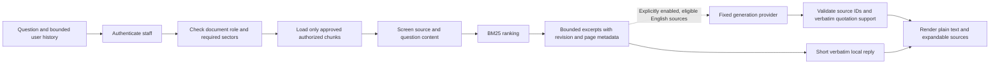

# CS Assistant: operation and engineering decisions

## 20 November: local AI and document workspace

The current interface adds a workspace rail, visible conversation history, a
Documents picker, composer attachment button and a reviewed-source selector.
**Upload & review** opens administrator controls inside the document dialog.
Pending sources are never selectable. A request that names an unavailable source
is rejected server-side, regardless of what a client displays. New Chat resets
the selection; restoring a page-only conversation restores its document selection.
**Summarize selection** covers bounded cited excerpts, not an entire long document.

The laptop-local option uses the official CPU build **llama.cpp b12559** and
**Qwen2.5-1.5B-Instruct Q4_K_M**, stored under ignored `backend/.local-ai/`.
`backend/scripts/setup_local_ai.py` pins source URLs/revisions and verifies published
SHA-256 checksums. It makes no system installation. The model is a decoder, not an
embedding model; semantic retrieval and pgvector quality gates are unchanged.

Start with `./start-local.ps1 -Demo -LocalAI`. The desktop batch launcher selects
local AI when its verified workspace manifest is present. The model server binds
to `127.0.0.1:11435`, requires a generated private API key, disables its web UI/MCP
proxy, uses four CPU threads and one generation slot. No paid API is activated.
Only the backend reads the generated access key; it is not exposed to the browser.
The runtime/model/key/logs are ignored by Git. Do not add them to commits.

The mode indicator checks the authenticated local models endpoint and expected
alias before showing **Local AI**. Offline/busy/invalid-output requests fall back
to document excerpts. Local generation is permitted for authorized, reviewed English
uploads; external generation for managed sources remains blocked. French/Kinyarwanda
generation remains blocked pending native review.

Output remains extractive. If a local model omits a citation, the application may
attribute the passage only when exact complete sentences match an authorized source.
Explicit forged IDs, paraphrases and added claims fail validation. This establishes
quotation provenance, not source truth or semantic relevance. A small CPU model can
still fail to produce a valid answer, so the UI identifies per-reply fallback.

### Upload approval boundary

API uploads now parse in a disposable Python process with a clean environment,
25-second wall timeout, 20-second CPU bound and bounded output. Windows Job Objects
apply 256 MiB per-process and 384 MiB total memory limits, with two active processes
for the Windows venv launcher/interpreter. Processes are killed/collected on timeout.
This is resource containment, **not** a full filesystem/network security sandbox.
Existing type/size/page/text limits and source review/approval still apply.

Uploads remain disabled until the owner explicitly approves this local extraction
environment. Only then may the demo be started with `-AssistantUploads` and a
nonempty `-ExtractionApprovalReference`. A user-approved reference may be recorded
in ignored `.local-ai/upload-approval.txt` for subsequent local-AI demo restarts;
an explicit `-AssistantUploads:$false` overrides it for that run. This never
activates ingestion on a deployed or production environment.

The opt-in browser test `16-local-assistant.spec.ts` uses `E2E_LOCAL_AI=true` and
only a disposable SQLite database, synthetic source and loopback model. Its execution
is also subject to extraction approval. Ordinary tests continue to disable generation.
See [20 November validation](VALIDATION_2026-11-20.md) for actual results and gates.

Read the [audit and prioritized plan](ASSISTANT_AUDIT_2026-11-19.md) and
[actual validation results](VALIDATION_2026-11-19.md) alongside this guide.

## What users see

Open `/app/assistant` or **CS Assistant** in the dashboard sidebar. The compact
welcome offers three example questions. Enter sends; Shift+Enter inserts a newline.
Messages scroll inside the chat panel while the composer remains below them.
Loading is announced, failures keep the question for retry, and the input regains
focus after a reply. New Chat starts a blank conversation. The history control
retains up to five earlier chats on this page, each with up to ten exchanges.
Leaving the page clears them: no localStorage, sessionStorage or chat database.

The header reads the authenticated assistant configuration. **Document mode** means
local source lookup, not a general-purpose LLM. If an operator enables generation,
the interface identifies AI-assisted mode and discloses provider processing before
the user sends. Failed settings loading blocks sending and offers retry. Language
and bounded follow-up options live under **Chat options**. Kinyarwanda is experimental
and requires native review; sources stay in their original language.

## How evidence reaches an answer



**Why authorize first?** A ranking algorithm must not see restricted text and filter
it afterward. A future vector service or reranker must receive only authorized
candidate IDs/text. All document-required sectors must be within the person's scope;
an administrator is not an implicit override for a document's role list. Packaged
general engineering procedures are available to all permitted staff roles.

**Why short quotations?** In local mode, the response shows the best-overlapping
complete sentence and, when it also matches question terms, its following sentence.
It includes at most two retrieved sources; a second must cover additional question
terms. Verification/verify/verified share a small repository-specific vocabulary
normalization for excerpt selection only, not a new retrieval model.
These remain contiguous, verbatim extracts. Full retrieved chunks remain under
**Sources**, with titles, reference identifiers, revisions and available page/section
metadata. This avoids duplicating whole documents in every answer. It is not a
model-written summary and does not establish semantic relevance or source truth.

**Why abstain?** Keyword overlap is not enough to infer a live fact. Pump-status
questions direct staff to Irrigation/Priority actions. Missing evidence returns an
explicit no-evidence response. Generic question scaffolding no longer creates
matches on its own. Copy and feedback controls remain available; feedback accepts
only a categorical vote, not question/answer text or user-selected identity.

**What do citations prove?** Local extracts are selected directly from identified
chunks. Optional generated answers must pass valid-ID and exact-sentence support
checks, otherwise local excerpts are returned. A real citation ID alone is not
verification of a claim. Source correctness, omitted context, relevance and human
institutional approval remain separate concerns. Logical sections for non-PDF
formats must not be described as physical printed pages.

## Knowledge administration

Administrator tools are collapsed under **Knowledge settings**. Search matches
source titles without treating SQL wildcard characters as search operators; filter
by review status. The list shows up to 200 matching revisions, actual stored chunk
counts, processing status/detail and stored embedding counts. Embedding counts can
span model revisions and do not prove that vector retrieval is active.

1. Leave `ASSISTANT_INGESTION_ENABLED=false` until the extraction environment is
   explicitly approved. Server and UI enforce this gate. A test fixture enabling
   ingestion in its disposable database is not approval to enable real uploads.
2. Once approved, upload only reviewed-for-ingestion procedures or authorized
   engineering/institutional material. Never upload participant records, grievances,
   personal documents or credentials. The parser is bounded but not isolated.
3. Inspect extracted chunks and references. A new version is pending and cannot
   answer questions. Approval requires a signed-in administrator and a nonempty
   review reference. Approval promotes that version and supersedes its predecessor.
4. **Prepare new version** retains the original metadata and access policy. New
   content does not replace the approved version until separately approved.
5. **Recheck / reindex** checks stored chunks without reparsing the original file.
   With no local model configured, it confirms lexical readiness; it does not claim
   embeddings were created. With an explicit local snapshot/revision configured, it
   fills missing embeddings for that model. It does not download models or approve
   a pending source. Repeat requests are idempotent for existing embeddings.
6. On model failure, the job records a safe failure message and partial new vectors
   roll back. Previously approved text remains available. Fix model provisioning or
   chunk limits and retry. Missing/empty/over-capacity chunks require a reviewed new
   version when uploads are approved; the original file is not retained for reparse.
7. Existing removal controls remove chunks/vectors from retrieval and retain version
   metadata marked rejected. Removal is a destructive administrative operation.

Upload, approval, reindex and removal record durable lifecycle audit events in the
existing audit table. Details contain identifiers/revisions/outcomes, not source
text, questions, answers, review-reference prose, model paths or credentials.
Process-local counters record index success/failure and existing retrieval/provider
events without document text. These are not a distributed observability system.

## API changes

| Endpoint | Permission | Purpose |
| --- | --- | --- |
| `GET /api/v1/assistant/config` | Staff | Generation/retrieval/upload capability flags; no keys/model paths |
| `GET /api/v1/assistant/documents?q=...&status=...` | Administrator | Bounded title search and version/processing metadata |
| `POST /api/v1/assistant/documents/{version_id}/reindex` | Administrator, same origin | Stored-text check and optional local embedding repair |

Existing ask, feedback, preview, upload, approval and removal endpoints are retained.
Mutation origin checks, request limits, roles, sectors and approval gates stay active.
There is no tool that lets the assistant edit field records, send SMS or pay airtime.

## Retrieval choices and experiments

BM25 remains the default because the measured lexical baseline is reproducible and
the corpus is small. The response still has known spelling, paraphrase and native
Kinyarwanda gaps. The expanded stopword list fixes two known false positives but is
not general semantic understanding. Reviewed negative questions should keep growing.

| Candidate | Current evidence | Decision |
| --- | --- | --- |
| Legacy title-weighted overlap | Offline baseline measured | Keep for comparison |
| BM25 | Offline ranking/mode/citation measurements | Default |
| Local embedding retrieval | Optional encoder exists; library/snapshot absent locally | No real-model quality claim or automatic download |
| BM25 + vectors + RRF | Fusion implemented; synthetic ordering tested | Benchmark with an approved real encoder before activation |
| PostgreSQL pgvector | Exact authorized-ID distance adapter and opt-in tests | No test DB URL in this run; no extension installation or HTTP switch |
| Cross-encoder reranking | Not implemented; no local model/benchmark | Defer until it improves reviewed relevance at acceptable latency |

pgvector is a database capability, not an embedding model. RRF combines rank
positions, not calibrated probabilities. A cross-encoder scores a question and
passage together, adding model work per candidate. None should be added merely to
make the architecture look more sophisticated. The current HTTP semantic adapter
encodes a bounded authorized corpus in memory; stored vector search is not wired
into that path and no ANN/HNSW performance is claimed.

Reproduce from `backend/`:

```powershell
../.venv/Scripts/python.exe scripts/evaluate_rag.py --method bm25 --output ../docs/ai/bm25-improved-results-2026-11-19.json
../.venv/Scripts/python.exe scripts/evaluate_citation_support.py --output ../docs/ai/citation-support-results-2026-11-19.json
```

After separately provisioning an approved local model and reviewing the fixture
labels, use `--method semantic` or `--method hybrid` with `--embedding-path` and
`--embedding-revision`. The evaluator fails instead of silently labeling lexical
fallback as semantic. PostgreSQL tests require an explicit disposable database
ending `_test` via `RAG_TEST_POSTGRES_URL`; they never install extensions. No real
provider call, model judge, model download or paid API is required for these tests.

## Remaining engineering limits

- This is a source-grounded procedure assistant, not live farm/pump analytics.
- Source review and heuristic PII/secret/injection screening are imperfect. Screening
  can reject benign source text and cannot guarantee detection of every secret.
- Source-derived instructions are never trusted system instructions; rendering is
  plain text. The assistant has no tools. These controls reduce, not eliminate, risk.
- Parsing needs a constrained worker before untrusted uploads can be approved.
- No persistent chat retention, streaming, cancellation or multi-process job queue.
- Reindexing is synchronous, bounded to 2,000 chunks, and can time out on slow local
  models. Long-document/model acceptance requires separate operational validation.
- Real embedding, pgvector and cross-encoder comparisons remain explicit release
  gates. Independent agricultural/source and native Kinyarwanda review is outstanding.
