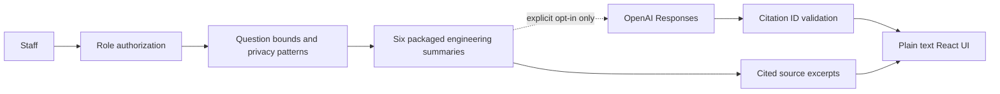

# RAG architecture and phased engineering audit

Audit baseline: branch `feature/document-assistant-20261117`, commit `8105ca6`.
Unrelated login changes and personal PDFs/application materials remain outside this work.
No arbitrary repository crawling is authorized or implemented.

## Existing architecture

FastAPI registers a staff-only POST endpoint; `Principal` resolves cookie, bearer or
service keys. Officer/planner/admin may access the same six public procedure summaries.
Sector restrictions exist for operational APIs but are irrelevant to this fixed,
non-personal corpus. SQLAlchemy models and Alembic revisions manage PostgreSQL/PostGIS;
SQLite is used by unit/E2E fixtures. Migration head at audit is `20261113_29`.
The assistant has no DB session, document tables, vector extension or SQL tools.

React/TypeScript uses a lazy staff route, Zod response parsing and plain-text output.
Ten browser-memory exchanges are independent questions. There is no conversational
context, persistent history, ingestion UI, feedback, copy control or page metadata.
The browser test exercises lookup, source expansion, missing evidence and clearing.

Backend dependencies already include httpx, SQLAlchemy, Alembic and psycopg. There
are no PDF/DOCX parsers, embedding frameworks or pgvector dependencies. CI tests
SQLite, PostGIS migrations/schema/workflows, React, Playwright and Docker. Its
PostGIS image does not establish pgvector availability. Docker is unavailable in
this local environment; historical PostGIS validation is not a new vector test.

## Findings and priorities

| Priority | Finding | Engineering response |
| --- | --- | --- |
| P0 before private ingestion | Current public corpus has no document ACL/approval lifecycle | Approval, role and sector filters before candidate retrieval; fail closed |
| P0 before generation activation | Regex catches only some PII; arbitrary secrets/names can evade it | Keep external calls off; approve processing policy separately; do not imply regex is complete |
| P1 | Keyword overlap returns tangential evidence and misses paraphrases/RW | Freeze baseline and relevance fixtures before improving retrieval |
| P1 | Valid citation IDs do not verify claims or resist all injection | Per-claim support evaluation, untrusted-context prompts, extractive fallback |
| P1 | No native-reviewed RW corpus/evaluation | Draft queries explicitly pending native review; no multilingual readiness claim |
| P1 | No ingestion/versioning/deletion, cache invalidation or persistent index | Bounded extraction, immutable versions, atomic chunk/index synchronization |
| P2 | Repeated tokenization, linear corpus scan, no retrieval metrics | BM25 index, bounded candidates, measured latency; optimize against actual scale |
| P2 | Provider integration coupled to orchestration; no usage/failure metrics | Provider interface, versioned prompts, bounded retries and content-free metrics |
| P2 | No context, feedback or document management | Bounded stateless user-supplied history; admin-only knowledge management |
| P1 before release | Existing dependency advisories; suggested frontend/pytest fixes include major versions | Separate compatibility-reviewed remediation; current audit scope/results in validation report |
| P3 | Optional cross encoder and HNSW unproven for six sources | Enable only after measured quality/scale benefits |

Existing defenses: authentication/roles, 1,200-character request bound,
10/minute/IP rate limit, fixed corpus/endpoint, 20s generation timeout, output cap,
redirects disabled, `store:false`, no SQL/tools/actions, HTML rendered as text,
fallback on provider/citation errors. An IP rate limit is neither a per-account
budget nor a distributed quota. No security claim depends on prompt obedience.

## Implementation sequence and gates

1. **Phase 1:** audit, 64 synthetic evaluation cases, reproducible legacy baseline,
   metric tests and documentation. No paid calls or new dependencies.
2. **Phase 2:** bounded approved-document loading/extraction/chunking; preserve page
   references, hashes and source classifications; quarantine before approval.
3. **Phase 3:** immutable document/version/chunk/job/evaluation tables; safe portable
   migration; optional pgvector capability and local SQLite fallback. Do not silently
   install an extension on a production database or hardcode model dimensions.
4. **Phase 4:** BM25, optional local embeddings and RRF; compare against frozen labels.
   Evaluate MiniLM English and multilingual BGE-M3 before production selection.
5. **Phase 5:** provider/prompt/context modules; fail-safe citations and generation.
6. **Phase 6:** existing UI improvements and admin-only source lifecycle.
7. **Phase 7:** native review, authorization/injection tests, content-free metrics.
8. **Phase 8:** reproducible deployment checklist, full regressions and explicit gaps.

Tests can validate implementation; production deployment, native review, source
approval, actual embedding quality and provider data policy require distinct evidence.
Live operational data services remain out of scope until independently approved.

## Implemented extension and explicit boundaries

The audit above describes `8105ca6`, not the new behavior. The extension adds
`services/rag/{ingestion,chunking,store,retrieval,embeddings,vectors,prompts,providers,citations,evaluation,safety,observability}.py`
and dedicated knowledge ORM tables/migration `20261117_30`. The API/UI now support
admin review, source permissions, version replacement/deletion and bounded context.
Default BM25 and optional local dense/RRF paths share the authorized corpus.
Generation is constrained to complete verbatim source quotations and remains off.
The protected metrics endpoint exposes counts/timing without content or identities.

The SQLite and PostgreSQL portable schema/lifecycle are validated. Actual embedding
quality, native pgvector/HNSW storage, cross-encoder reranking, native-reviewed RW,
institutional agriculture sources, isolated parsing workers and hosted release are
not completed. Persistent vectors have a tested adapter, but HTTP dense retrieval
currently uses the model's bounded in-memory cache. Job/evaluation tables are provided;
there is no durable ingestion queue or automatic benchmark write-back. These limits
remain visible in the [phase report](VALIDATION_2026-11-18.md).
