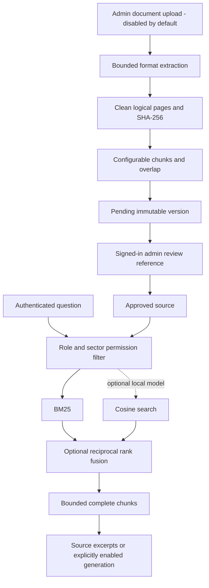

# Retrieval pipeline and ranking mathematics

`ingestion.extract` accepts PDF, DOCX, UTF-8 TXT/Markdown/CSV/JSON up to 5 MiB and
one million extracted characters. PDF has a 200-page cap; encrypted/empty PDFs are
refused. DOCX archive/expansion/XML declarations are bounded/refused, external links
are never followed, macros are refused. Binary originals and filenames are not
persisted. PDFs retain printed logical page numbers; other formats get logical
section 1, and DOCX pagination is not reconstructed. No OCR is provided.

`chunk_pages` supports fixed/token windows and paragraph/recursive/Markdown-heading
boundaries. Baseline 512/64 counts **whitespace tokens**, not model tokenizer tokens.
Oversized blocks split into windows; overlap never crosses pages. Heading metadata
is preserved only for heading-aware Markdown extraction; PDF heading detection is
not implemented. Strategies are deliberately modest, not a claim of universal
document-layout understanding. Configuration is a service parameter; HTTP currently
uses the baseline. Long single tokens still count toward extracted-character caps.

SHA-256 detects repeated source bytes. Retrying the same document/version returns
the same version; duplicate content uploaded as a new document is refused. A changed
source becomes a pending version while the previous approved version remains live.
Approving it supersedes the previous approved version transactionally. Metadata/ACLs
are immutable per document to avoid silently widening old content access. Delete
removes all chunks/vectors and marks metadata deleted/rejected. Approval metadata
remains for audit. Ingestion jobs track successful extraction/chunk indexing;
pre-extraction failures return safe errors and are not stored as failed-job rows.
Concurrent uploads rely on uniqueness constraints and return a retryable error.

## Keyword ranking

BM25 sums, over matching query terms:

`log(1 + (N-df+0.5)/(df+0.5)) * tf*(k1+1)/(tf+k1*(1-b+b*L/avgL))`

Here `k1=1.2`, `b=0.75`; the title is counted twice. Rare terms get more weight;
term frequency saturates and long documents receive length correction. There is no
stemming, typo correction, synonym expansion or automatic RW translation. `legacy`
retains the original distinct-overlap/title-weight baseline. Neither proves a
question is answerable merely because words overlap.

## Optional dense retrieval and fusion

Cosine ranks local encoder outputs. A configurable threshold rejects weak dense
matches. Hybrid retrieval combines lists by `RRF(d)=sum(1/(60+rank_i(d)))`, which
uses ranks instead of pretending incomparable raw scores share units. It selects
at most configured top-k. No cross-encoder reranker is activated or benchmarked;
adding one would require a local model and measured benefit.

Context construction keeps full chunks under a 16,000-character budget. It never
truncates a passage and then presents that as its full evidence. Model-token budgets
are a separate limit. If no relevant sources survive, return no evidence.

Benchmark: 128/256/512/768-token settings all yielded six chunks and document
Recall@3 0.83 on this corpus (`python scripts/check_rag_chunks.py`). This does not
establish an optimal chunk size for long agriculture sources.
